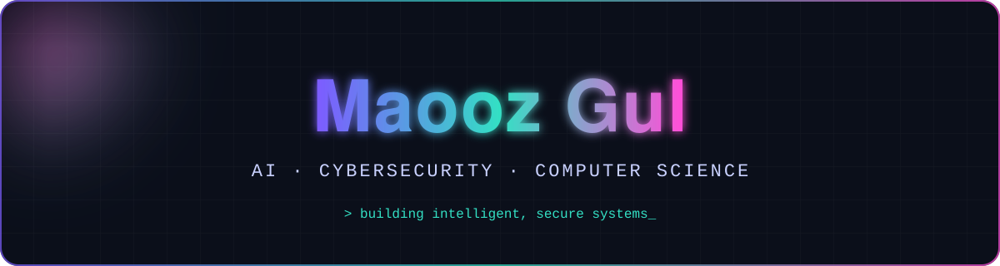

<div align="center">

<a href="https://github.com/maoozgul20">
  
</a>

<a href="https://github.com/maoozgul20">
  
</a>

<br>

<a href="mailto:maoozgul20@gmail.com"></a>
<a href="https://github.com/maoozgul20/maoozgul20-portfolio.github.io"></a>


</div>


## 👋 About me

<table>
<tr>
<td width="58%" valign="top">

I'm a **BS Computer Science** graduate from Qurtuba University, Peshawar, drawn to the place where **Artificial Intelligence** meets **Cybersecurity**.

My final-year work focuses on **machine-learning-based intrusion detection**. Along the way I've built IoT monitoring systems and web apps. Next, I want to do research on models that can tell genuine data from manipulated or malicious data, and explain *why*.

- 🔭 Working on **AI-generated content detection**
- 🌱 Learning explainable ML and network security
- 🎓 Applying for Master's programs and the CSC scholarship
- 💬 Ask me about intrusion detection, ML pipelines or IoT
- 🎨 I'm also a graphic designer

</td>
<td width="42%" valign="top">

```python
class MaoozGul:
    role     = "AI + Security Engineer"
    based_in = "Peshawar, Pakistan 🇵🇰"
    degree   = "BS Computer Science"

    focus = [
        "Intrusion detection",
        "AI-content detection",
        "Explainable ML",
    ]

    def next_step(self):
        return "MS in AI & Cybersecurity 🚀"
```

</td>
</tr>
</table>


## 🛠️ Tech stack

<div align="center">


<br><br>

| 🤖 AI & ML | 🛡️ Security | 🌐 Web & Systems | 📡 IoT | 🎨 Other |
| :---: | :---: | :---: | :---: | :---: |
| Python · PyTorch<br>scikit-learn<br>Dataset prep<br>Model evaluation | Intrusion detection<br>Anomaly detection<br>Network security | HTML · CSS · JS<br>React · Node.js<br>PHP · SQL | ESP32<br>MQTT<br>Sensor automation | Graphic design<br>Digital media<br>MS Office |

</div>


## 🚀 Featured projects

<table>
<tr>
<td width="50%"></td>
<td width="50%"><a href="https://github.com/maoozgul20/SpendWise-personal-finance-application"></a></td>
</tr>
<tr>
<td width="50%"><a href="https://github.com/maoozgul20/Weather-App"></a></td>
<td width="50%"><a href="https://github.com/maoozgul20/Employee-Database-Managemrnt"></a></td>
</tr>
</table>

<div align="center"><sub>👆 Click a card to open the project</sub></div>

<details>
<summary><b>📖 More about each project</b> (click to expand)</summary>

<br>

**🏫 Smart Campus (FYP, in progress).** An AI-based smart campus system for campus services, monitoring and resource management. It includes a 3D campus environment for exploring facilities, information and resources. I'm working on the AI system, data processing and evaluation.

**💸 SpendWise (completed).** A responsive personal finance dashboard built with React and Vite. It tracks income, expenses, budgets and savings, with category filters, monthly budgets, charts and spending insights. Data is stored offline in localStorage, and it has light and dark modes.

**🌤️ Advance Weather App (completed).** Live weather for any city from the OpenWeatherMap API, with a glassmorphism UI, animated details and backgrounds that change with the weather.

**🗄️ EmployeeDB (completed).** A web-based employee management system in PHP and MySQL with full CRUD and search, server-side validation, prepared statements against SQL injection, and a responsive UI.

</details>


## 🎓 Journey


## 📊 GitHub stats

<div align="center">


</div>


<div align="center">

## 🤝 Let's connect

I'm always happy to talk about AI, security or research opportunities.

<a href="mailto:maoozgul20@gmail.com"></a>


</div>
