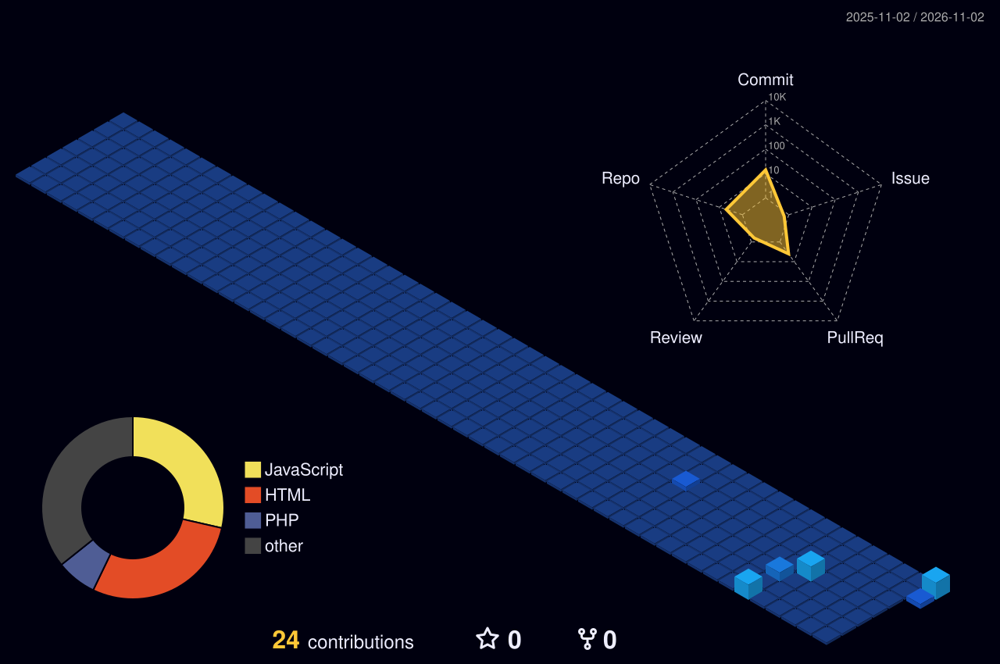

  

  

  

  

## 🚀 Featured Projects

<table>
<tr><th>Project</th><th>What it is</th><th>Tech</th><th align="center">Status</th></tr>
<tr><td><b>Smart Campus</b></td><td>AI-based smart campus system for services, monitoring and resource management, with a 3D campus environment</td><td><code>AI</code> <code>3D</code></td><td align="center">In progress (FYP)</td></tr>
<tr><td><a href="https://github.com/maoozgul20/SpendWise-personal-finance-application"><b>SpendWise</b></a></td><td>Personal finance dashboard: budgets, charts, spending insights, light and dark modes</td><td><code>React</code> <code>Vite</code></td><td align="center">Done</td></tr>
<tr><td><a href="https://github.com/maoozgul20/Weather-App"><b>Advance Weather App</b></a></td><td>Live weather for any city with a glassmorphism UI and backgrounds that follow the weather</td><td><code>JavaScript</code> <code>OpenWeatherMap API</code></td><td align="center">Done</td></tr>
<tr><td><a href="https://github.com/maoozgul20/Employee-Database-Managemrnt"><b>EmployeeDB</b></a></td><td>Employee management with CRUD, search, validation and prepared statements against SQL injection</td><td><code>PHP</code> <code>MySQL</code></td><td align="center">Done</td></tr>
</table>

<a href="https://github.com/maoozgul20?tab=repositories"><b>→ See all repositories</b></a> &nbsp;|&nbsp; <a href="https://github.com/maoozgul20/maoozgul20-portfolio.github.io"><b>→ Portfolio</b></a>

  

### 🌃 My contribution city

*Every commit raises another building. Rebuilt automatically every day.*

  

### 📊 GitHub stats

  

  

  

**Keep learning, keep building, keep it secure.** 🛡️

